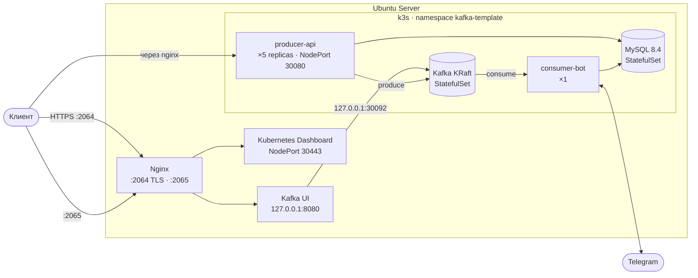

<div align="center">

# ⚓ k8s-lab

**Домашняя лаборатория: k3s-кластер на одном сервере, развёрнутый через Ansible,<br>с микросервисами на Kafka и MySQL, Helm-чартами и Nginx на входе.**

<p>
  
  
  
  
  
  
  
</p>
<p>
  
  
  
  
  
  
</p>

</div>


## О проекте

Учебный стенд, на котором отрабатывается весь путь от «голого» Ubuntu-сервера до работающих микросервисов:

1. **Ansible** готовит сервер: обновляет пакеты, ставит Docker, k3s, Nginx и клонирует репозитории.
2. **k3s** поднимает одноузловой Kubernetes-кластер. NodePort-ы слушают только `127.0.0.0/8`, поэтому наружу они не торчат.
3. **Манифесты и Helm-чарты** разворачивают в кластере MySQL, Kafka (KRaft), producer-API и Telegram consumer-бота.
4. **Nginx** на хосте проксирует Kubernetes Dashboard (по TLS) и Kafka UI.

Предметная область приложения — агрегатор баскетбольных матчей (БД `basketball_aggregator`): команды, игроки, игры и подписки пользователей на них.


## Архитектура




## Быстрый старт

### 1. Подготовка сервера (Ansible)

```bash
cd ansible
ansible-galaxy collection install -r requirements.yaml

# Нужные роли раскомментируй в site.yaml
ansible-playbook site.yaml --ask-vault-pass
```

Выборочный запуск по тегам:

```bash
ansible-playbook site.yaml --tags k3s            --ask-vault-pass   # k3s + Helm + Dashboard
ansible-playbook site.yaml --tags k3s_dashboard  --ask-vault-pass   # только Dashboard
ansible-playbook site.yaml --tags nginx_cert     --ask-vault-pass   # только сертификат
ansible-playbook site.yaml --check --diff        --ask-vault-pass   # сухой прогон
```

> Для `group_vars/vault.yml` (зашифрован через `ansible-vault`) нужны переменные с SSH- и sudo-паролями (`vault_lafazan_lab_ssh_password`, `vault_lafazan_lab_become_password`) и GitHub-токеном для роли `repository`.

### 2. Деплой приложения (k3s)

```bash
cd k8s
cp .env.example .env            # заполни значения

# Неймспейс, секреты, конфиги
kubectl apply -f namespace.yaml
kubectl -n kafka-template create secret generic app-secrets --from-env-file=.env
kubectl -n kafka-template create configmap mysql-init --from-file=init.sql=scripts/init.sql
kubectl apply -f configmap.yaml

# MySQL и Kafka
kubectl apply -f mysql/ -f kafka/
kubectl -n kafka-template rollout status statefulset/mysql --timeout=300s
kubectl -n kafka-template rollout status statefulset/kafka --timeout=300s

# API и бот (тег образа обязателен)
helm upgrade --install producer-api ./charts/api -n kafka-template --set image.tag=v1.0.0 --atomic
helm upgrade --install consumer-bot ./charts/bot -n kafka-template --set image.tag=v1.0.0 --atomic
```

Подробности, откат и отладка: [`k8s/README.md`](k8s/README.md).


## Ansible-роли

| Роль | Что делает |
|---|---|
| `packages` | `apt dist-upgrade`, autoremove, проверка необходимости перезагрузки |
| `docker` | Docker Engine и плагины, standalone Compose, LazyDocker, cron-очистка билд-кеша |
| `repository` | Ставит git и клонирует список репозиториев в `/root/lab` |
| `nginx` | Устанавливает Nginx, генерирует самоподписанный сертификат с SAN для Dashboard |
| `k3s` | Устанавливает k3s с ограничением NodePort на loopback, Helm и Kubernetes Dashboard |


### Вход в Kubernetes Dashboard

```bash
# токен для ServiceAccount admin-user (создаётся ролью k3s)
kubectl -n kubernetes-dashboard create token admin-user --duration=24h
```


## Выкатка и откат

```bash
# Новая версия (теги только конкретные, не latest)
docker build -t lccodder/kafka-template-producer:v1.0.1 ./producer
docker push  lccodder/kafka-template-producer:v1.0.1
helm upgrade --install producer-api ./charts/api -n kafka-template --set image.tag=v1.0.1 --atomic

# Откат
helm history  producer-api -n kafka-template
helm rollback producer-api -n kafka-template        # на предыдущую ревизию
```

`--atomic` ждёт готовности подов и при провале сам откатывает релиз. `producer-api` обновляется через `RollingUpdate` (`maxUnavailable: 0`), без простоя.
